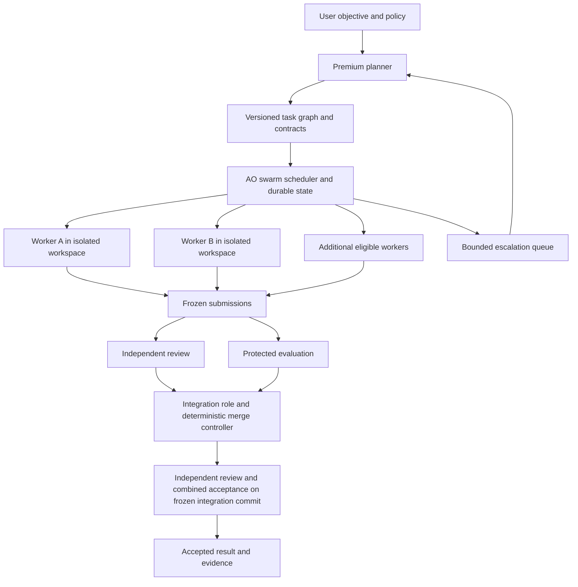

# Praxis Swarm build plan

This document preserves the full fifteen-package build scope agreed on 28 October 2026. Read [PROGRESS.md](PROGRESS.md) for current status, evidence, blockers, and the next eligible work; this plan is not a completion record. [UPSTREAM.md](UPSTREAM.md) records the pinned foundation and local setup boundaries.

**First-release override, 29 October 2026:** follow the compact
[GitHub launch plan](GITHUB_LAUNCH_PLAN.md). A developer preview and a narrower
supervised AO-based alpha may ship before the full SWM-00–14 release gate. Existing
qualification requirements still govern their original execution paths; these
milestones do not become complete merely because the preview is public.

**Praxis Swarm** is the working name for this independent AO-derived project. It does not imply OpenAI ownership, endorsement, or affiliation. The swarm capabilities below are implementation targets until their acceptance evidence is recorded.

## 1. Product and outcome

Build a standalone public project that lets a user assign an engineering objective to a premium planning model, then have multiple selected models implement, review, evaluate, and integrate work concurrently. Astra is the first intended planning configuration; model names and providers remain configurable. God's Drunken Bet is one integration project alongside unrelated software projects.

The product includes a shared Kanban board, dependency-aware scheduling, durable handoffs, isolated workers, independent reviewers, protected acceptance tests, an integration role, interruption recovery, and usage controls. Parallel implementation is part of the first live swarm milestone and remains part of the release criteria.

The main user workflow is: choose a repository and objective; select models and operating limits; review the proposed work graph; start the swarm; inspect progress and evidence; resolve exceptions when needed; receive an integrated, tested change. Within the approved objective and operating policy, eligible work should proceed without repeated confirmations.

Use the premium model for architecture, ambiguous decisions, and difficult escalations. Deterministic software handles claims, deadlines, budget reservations, evidence checks, and routine coordination. Workers can propose new tasks; additions outside the approved objective require a scope decision. Independent work continues while an escalation waits.

## 2. Architecture decision and reuse

**Build a maintained fork of Agent Orchestrator (AO), with a native swarm service in its Go backend and a complete workflow in its Electron/React UI.** Preserve its upstream history and keep our changes concentrated in identifiable modules. Use its existing execution, workspace, observation, storage, API, and frontend boundaries.

This is the build direction, subject to a reproducible local build in SWM-00. If that fails, diagnose and record the specific incompatibility; evaluate the same capability against Gas Town. A foundation change must update this plan and its contracts. It must not silently replace the swarm with solo execution.

AO will own execution and durable scheduling. OpenSwarm contributes selected routing calculations; Gas Town contributes integration patterns. Neither will run a competing scheduler against the same work. Existing Praxis code contributes preservation, evidence concepts, and regression cases rather than a second production database.

| Source and pinned revision | Use in our project | Boundary |
| --- | --- | --- |
| [Agent Orchestrator `71bb19f5947a`](https://github.com/OrchestratorInc/agent-orchestrator/commit/71bb19f5947a64853ee6d11225bc896563878c50) — root Apache-2.0; metadata discrepancy recorded in [UPSTREAM.md](UPSTREAM.md) | Foundation: session manager, workspaces, native agent adapters, lifecycle, SQLite, review/PR services, desktop/API | Extend the public local implementation. The missing `private/ao-cloud` module is not part of the inspected local build path. |
| [OpenSwarm `b2a70d436ad7`](https://github.com/surlymochan/openswarm/commit/b2a70d436ad72f0c5b036730fc86b749ddc68af7) — Apache-2.0 | Adapt routing, concurrency-limit validation, bounded context selection, and usage-policy calculations into tested Go modules | Do not import its launcher, batch scheduler, process discovery, ledger, or optional-pass acceptance behavior. |
| [Gas Town `466aa41c83ee`](https://github.com/gastownhall/gastown/commit/466aa41c83ee73b1fa0eb79eb9d172fb1eca9476) — MIT | Adapt merge serialization, exact submitted-commit checks, combined-result gates, and conflict-resolution task patterns | Do not inherit its sandbox-bypassing agent defaults or its entire management stack. |
| [Beads `c153e3b9c94a`](https://github.com/gastownhall/beads/commit/c153e3b9c94a261f5699fd21cc35887d6781f979) — MIT | Reference dependency graph, atomic claims, handoff, and merge-slot semantics | AO SQLite remains the runtime authority. No additional Dolt database is required for this architecture. |
| [OpenHands SDK `47bbc5e8392c`](https://github.com/OpenHands/software-agent-sdk/commit/47bbc5e8392c4c75b7f77a1da38bed4a9f53d6a5) — MIT | Reference workspace lifecycle and per-response usage normalization | Add explicit network/mount policies and usage deduplication; do not pull in a second execution framework just for metrics. |
| [SWE-bench `02e7a74ffd0b`](https://github.com/SWE-bench/SWE-bench/commit/02e7a74ffd0b707aab73d203fe87bdc7c76afc8e) — MIT | Adapt isolated patch-evaluation structure and regression/fix separation | Our oracle stays protected; skipped required tests and XFAIL do not count as passing. Do not inherit unnecessary container privileges. |
| [Temporal SDK `2a7d321cbe53`](https://github.com/temporalio/sdk-python/commit/2a7d321cbe538c38f7c9a45fcc4c6c44733ecf85) — MIT | Reserve option if AO cannot satisfy the required durable-operation semantics | Introduce only after a documented gap analysis, with one clear owner of orchestration. Its SDK-core submodule was not downloaded. |
| [LangGraph `5c96bce8d370`](https://github.com/langchain-ai/langgraph/commit/5c96bce8d370450c05af5ae740e5d1f936a24f53) — MIT | Reference resumable decision graphs | No additional runtime dependency is needed for the initial AO implementation. |

The source links above pin full commit IDs and remain usable outside the original research workspace. The original download manifest, archive hashes, source snapshots, and findings remain preserved outside this fork; they are historical research records, not runtime qualification. [UPSTREAM.md](UPSTREAM.md) records AO provenance and its license metadata discrepancy. Preserve required notices and check per-package/file licensing before redistributing adapted code. Current validation outcomes belong in [PROGRESS.md](PROGRESS.md).

### Concrete extension points

Paths below are relative to the pinned AO source:

- Reuse `backend/internal/service/session/delegation.go` and `session_manager/`; extend the existing client request identity into durable swarm dispatch. Do not write another subprocess launcher.
- Reuse `backend/internal/domain/projectconfig.go` role settings and `adapters/agent/modelcatalog/` discovery. Explicitly configure reviewers: the existing empty-reviewer fallback must not silently select a different provider for a restricted run.
- Add `backend/internal/service/swarm/` plus domain types, ports, queries, and migrations in the existing backend structure. Wire it through `backend/internal/daemon/lifecycle_wiring.go`.
- Reuse `backend/internal/service/review/` and `service/pr/action_service.go`; add task-level acceptance and combined integration above existing PR readiness checks.
- Extend `backend/internal/httpd/` and generated OpenAPI clients. Proposed `/api/v1/swarm-runs` routes are new work, not existing endpoints.
- Extend the existing `NewTaskDialog.tsx`, `TaskModelControls.tsx`, and `SessionsBoard.tsx` workflows. Display status must continue to derive from server facts.

Proposed new project-owned modules: `service/swarm/{planning,contracts,scheduler,routing,budgets,evidence,integration,recovery}`. Exact file boundaries should follow AO conventions; these are proposed responsibilities, not an instruction to create empty abstractions.

## 3. Runtime contracts

**Roles.** Planner owns objectives, decomposition, interfaces, and difficult decisions. Workers own assigned changes. Reviewers inspect frozen submissions in separate sessions. The evaluator executes protected checks. The integration agent may resolve conflicts within its assignment; deterministic code controls acceptance and updates to the destination branch. One model may fill several roles across separate sessions without allowing a worker to approve its own submission.

**Task packet.** Record project/run/task/attempt IDs; protocol version; objective and explicit non-goals; dependency IDs and required artifact versions; source commit plus preserved dirty-work manifest; permitted paths and semantic resources; interface contracts; acceptance oracle ID/hash; resolved tool paths and hashes; selected model/effort; permissions; budget reservation; retry/escalation rules. Store large artifacts by reference and hash. Pin mandatory context; report any omitted optional context.

**Shared context.** Project-wide decisions and interfaces are versioned artifacts. Workers get the relevant slice plus permitted retrieval, rather than the full transcript. An interface change creates a new contract version and invalidates affected pending acceptance; unrelated tasks can continue. Workers communicate through structured questions, proposals, and evidence-linked findings.

**State.** Keep task state separate from session/process state. Intended task path: proposed → ready → reserved → running → submitted → review/evaluation → integration-ready → integrating → accepted. Failure, retry, needs-input, cancellation, and superseded attempts retain their evidence. A worker exit or reviewer approval alone cannot produce accepted status.

**Admission.** In one database transaction, check dependencies, scope/invariant conflicts, capacity, and budget; reserve them and write dispatch intent. Launch outside that transaction through AO. Reconcile by immutable request/operation identity. An uncertain launch retains its reservation until its real outcome is established; it is never automatically duplicated.

**Permissions.** Worktrees separate changes, not process authority. Bind write access to the assigned workspace, keep coordinator state and evaluation inputs unavailable for worker modification, and verify the actual backend's permission behavior. Evaluate untrusted candidate code in a controlled environment with explicit mounts/network access. Preserve all original user changes.

**Model identity.** Track requested model, resolved launch configuration, provider-reported model, and unavailable telemetry separately. Missing executed-model telemetry is unknown; it does not by itself block an explicitly authorized diagnostic. It does prevent unsupported claims about which model achieved a result. Model substitutions and new billing routes require an explicit configured policy.

**Usage.** Track per-attempt input/output/cache/reasoning fields without double counting, premium-model usage, total usage, runtime, and account-window observations separately. Key reservations by the actual provider/account/shared allowance bucket; different model names do not establish different allowances. Quota percentages are not exact token balances. Reserve estimated usage before concurrent dispatch, reconcile actual receipts idempotently, and include failures/reviews/integration. Label estimates and stale/unknown observations. Hard token or spend caps may be advertised only where the runtime/provider actually enforces them; otherwise expose admission thresholds, stop margins, and possible in-flight overrun.

## 4. Work packages

Every package produces a bounded diff, its stated evidence, and an update to [PROGRESS.md](PROGRESS.md), the canonical build progress. These are dependency gates within the full swarm build. A blocked dependent package does not suspend unrelated eligible work.

### SWM-00 — Establish the public upstream baseline

Dependencies: none.

Create the new development repository from AO's pinned upstream history, outside the game and preserved snapshots. Record the upstream remote/revision, inherited notices, build prerequisites, dependency locks, and local-data locations. Select a product working name without implying OpenAI ownership. Check package-level license metadata. Inspect install/build scripts before executing them; run in the new checkout with isolated application state.

The snapshot declares Go 1.27.1, Node 24, npm 10, Git, and source-run tmux requirements on macOS. Reproduce `go build ./...` and `go test -race ./...` from `backend/`, then frontend typecheck/tests and a local desktop launch using the pinned development instructions. Review packaging's additional runtime downloads. Use lockfile-consistent dependency installation; resolve documented setup inconsistencies explicitly.

Acceptance: public local daemon and UI run without the private cloud module; baseline test failures are resolved or explicitly isolated from our changes; a fresh setup can reproduce the result. Record one canonical build-progress state with SWM-01 and SWM-02 eligible concurrently. Existing game/Praxis stores and Q1/Q2 evidence remain untouched.

### SWM-01 — Qualify model and permission adapters

Dependencies: SWM-00.

Use AO's catalog to resolve the user's premium, worker, reviewer, and integration model selections. Implement per-role allowed fallbacks, requested/reported identity fields, supported effort validation, and a capability report bound to runtime binary/version and permission configuration. Cover auth failure, model unavailability, cancellation, and read-only review. Keep account credentials in existing credential mechanisms.

Acceptance: explicit model/effort survives dispatch; unsupported settings return actionable errors; no silent provider substitution. A worker cannot modify coordinator/evaluator storage, and a reviewer cannot change the submission. A changed runtime invalidates only the affected capability evidence. Record separate test-mode and live-adapter results.

### SWM-02 — Add authoritative run, task, attempt, and reservation state

Dependencies: SWM-00.

Add versioned task contracts, a validated dependency DAG, immutable attempts, dispatch intents, scope/invariant reservations, usage reservations, review/evaluation records, and integration records to AO's existing storage. Use additive migrations and existing SQL generation. Adopt explicit client request IDs and lease generations. Design the minimum APIs consumed by the scheduler and UI.

Acceptance: concurrent claims cannot reserve the same task or incompatible resource; duplicate requests return the same logical operation; dependency cycles and stale versions are rejected. A crash between reservation and launch is reconciled without a second launch. No transaction remains open during model execution.

### SWM-03 — Build planning and compact handoff composition

Dependencies: SWM-02.

Add premium-planner output schema validation, decomposition into parallel tasks, interface contracts, acceptance specifications, and a bounded context composer. Adapt OpenSwarm's `select_lessons`/`select_patterns` ideas using approved, hash-addressed inputs. Explicitly define error semantics in contracts; the Q1 setter-exception ambiguity becomes a regression example. Generate entry instructions from the canonical task/attempt state.

Acceptance: a fresh worker can identify exactly one current assignment and its completion conditions. Missing mandatory context fails validation; optional truncation is visible. Old contract/protocol packets cannot resume as a newer trial. Pause/resume uses the recorded interpreter/tool identities or an explicit migrated attempt. Contradictory startup instructions are detected.

### SWM-04 — Implement model routing and usage admission

Dependencies: SWM-01, SWM-02.

Port selected pure calculations from OpenSwarm's `shift_effort`, `clamp_effort`, `worst_window`, `plan_codex`, `route`, and budget helpers. New contract: `RecommendRoute(task, catalog, quotaSnapshot, policy) -> RouteAdvice`; AO validates and reserves the recommendation. Keep routing separate from dispatch. Adapt OpenHands-style receipt fields with response/operation deduplication. Use deterministic task titles and summaries where adequate; cosmetic background model calls must be disabled or explicitly budgeted, including AO's optional title refinement.

Acceptance: supported model bounds and policy apply even to explicit overrides. Used usage plus active reservations cannot exceed the configured admission allowance. Unknown quota remains unknown; passing a reset timestamp triggers refresh, not assumed zero use. Cancelled/failed/review attempts are accounted for. No automatic premium-model upgrade is triggered solely by apparently spare quota. Show premium versus total usage independently.

### SWM-05 — Implement concurrent scheduling and workspace ownership

Dependencies: SWM-01, SWM-02, SWM-03, SWM-04.

Schedule dependency-ready tasks through AO's session manager. Reserve path and semantic resources atomically; use actual filesystem case/Unicode/path/inode identity where relevant. Preserve dirty starting work in the source manifest. Validate link aliases at submission boundaries. Separate maximum workers, reviewers, provider slots, and project limits. Use a rotating ready queue or equivalent fairness policy across projects.

Acceptance: two eligible workers actually overlap in time in separate workspaces; dependent work waits; conflicting work is serialized. Case aliases and hard links reproduce the old failures and are rejected or safely isolated. Unknown process ownership cannot free a slot for overlapping work. A blocked task does not stop unrelated tasks.

### SWM-06 — Demonstrate the first live parallel swarm

Dependencies: SWM-01 through SWM-05.

On a disposable non-game repository, use the selected premium planner to issue two meaningful independent implementation tasks under a shared interface contract. Launch two selected workers concurrently and collect frozen candidate commits plus real execution traces. Exercise one blocked task while the other finishes. Reserve explicit usage/time limits and use existing authenticated accounts.

Acceptance: evidence proves two distinct live worker sessions with overlapping execution, preserved source identity, separate writes, and recorded routing. Candidate collection works without the planner polling continuously. This milestone proves parallel execution; it does not yet declare the candidates accepted. Keep them available for SWM-07 through SWM-09. Do not replace a failed multi-agent trial with solo work and call it passed.

### SWM-07 — Bind independent review to frozen submissions

Dependencies: SWM-01, SWM-02, SWM-03; SWM-06 supplies live submissions.

Reuse AO reviewer sessions and add task-level provenance binding. A review references task/attempt, exact source/submission hash, contract, reviewer dispatch/session, reviewer permissions, findings artifact, and completed execution evidence. Freeze before review; changes create a new submission requiring new review. Configure independent sessions explicitly, with different models/families where the user's policy requests them.

Acceptance: fabricated review dictionaries, missing sessions, stale source hashes, self-review, and incomplete runs cannot authorize integration. A genuine critical finding returns a bounded repair task. Demonstrate the complete rejection → repair → new frozen submission → fresh review/evaluation loop, followed by integration under SWM-09. Exhausted repair attempts enter an explicit blocked/escalation state while unrelated work continues; charge every attempt to its budget. A reviewer can inspect relevant source and evidence rather than being restricted to an uncontextualized diff.

### SWM-08 — Add protected independent evaluation

Dependencies: SWM-01, SWM-02, SWM-03; parallel with SWM-07.

Adapt SWE-bench's separation of candidate patch, controlled execution environment, and grading. The coordinator owns evaluator inputs, test selection, and result collection. Project-defined tests supplement protected acceptance; candidate changes cannot rewrite the oracle. Identify results by source, patch, evaluator, toolchain, and environment hashes.

Acceptance: required tests must actually execute. A known-bad candidate and a no-op test bearing the expected test name both fail; required skip/XFAIL cannot count as success. Baseline-fail/candidate-pass controls demonstrate fix behavior where applicable. Cached results for another identity are rejected. Candidate test processes cannot alter acceptance records or read unrelated account credentials.

### SWM-09 — Integrate ready submissions and verify the combined result

Dependencies: SWM-05, SWM-07, SWM-08.

Add an integration worktree and merge controller, adapting Gas Town's submitted-commit and merge-slot patterns. Combine integration-ready submissions against a recorded base. Route conflicts to an integration agent with bounded authority. Freeze the resulting candidate; independently review any integration-authored changes and run combined acceptance against that exact commit. Further edits invalidate the affected review/evaluation evidence. Reuse AO PR checks for the final destination operation and compare expected destination HEAD before updating it.

Acceptance: a pair of individually passing patches that fail together is rejected. Original worker reviews cannot authorize new code introduced during conflict resolution. Advancing the destination invalidates stale integration proof. Unrelated user changes survive. An integration agent cannot self-approve by editing evidence. Local integration, opening a PR, and merging a protected destination follow distinct configured permissions. Accepted status requires the configured integrated-result proof; it is never an entry requirement for integration.

### SWM-10 — Recover reliably and stop cleanly

Dependencies: SWM-05, SWM-07, SWM-08, SWM-09.

Extend AO lifecycle/adoption with run-level reconciliation, durable external-operation identities, heartbeat/lease handling, bounded retries, and escalation. Distinguish a slow or disconnected process from a dead one. Pause new admissions without abandoning running work. Stop/cancel settles process ownership, reservations, and artifacts. Resume premium planning when available without duplicating completed work.

Acceptance: inject termination before launch, after launch-before-recording, during review/evaluation, after integration-before-closeout, and during quota exhaustion. Each recovery neither duplicates paid work blindly nor loses accepted artifacts. Cancelled generations cannot submit late results. PID reuse cannot kill unrelated processes. Uncertain descendants are reported and retained as unresolved ownership rather than marked stopped.

### SWM-11 — Complete the desktop and CLI user workflow

Dependencies: SWM-02, SWM-03 for initial UI; SWM-04 through SWM-10 for completion.

Extend AO's existing board and model controls: objective entry, plan/dependency view, per-role model settings, concurrency/budget settings, launch, pause/resume/stop, questions, reviews, integration, and evidence export. Show blocked reasons and the user's required action. Link each task to its actual workspace and session. Keep requested, reported, and unknown model/usage values distinguishable.

Acceptance: a new user completes the whole workflow without editing SQLite or internal JSON. Restart preserves meaningful board state. Quota unknown, unavailable model, review failure, merge conflict, and interrupted run have clear recovery paths. State shown by desktop and CLI agrees with the backend. Capture a working demo and screenshots.

### SWM-12 — Add reusable project adapters and handoff procedures

Dependencies: SWM-03, SWM-08, SWM-09, SWM-11.

Define a project adapter for build/test commands, protected acceptance, toolchain, permitted paths, semantic resources, and artifact rules. Supply Python, TypeScript/web, and C++ examples; add God's Drunken Bet as an integration fixture without making it a framework dependency. Provide skills/entry prompts for planning, worker execution, review, integration, and resuming a run.

Acceptance: the same swarm runtime completes a useful change in at least two unrelated repositories; one is outside game development. Fresh-reader tests find one current task and next action. Imported historical Spark/Q1/Q2 documents remain evidence, not active instructions. Core code contains no personal paths, game names, or account-specific model assumptions.

### SWM-13 — Measure reliability and premium-model efficiency

Dependencies: SWM-06 through SWM-12.

Compare premium-only execution, a sequential premium-to-worker handoff, and the full parallel swarm on the same frozen tasks and acceptance oracles. Include interface changes, independent features, an intentional conflict, ambiguous requirements, interruption, and a failed test. Use fresh workspaces, repeated runs, recorded model/tool versions, and matched budgets; reserve evaluation tasks not used to tune the workflow.

Acceptance: publish raw receipts plus accepted-task rate, premium/total usage, elapsed time, repair cost, review/integration overhead, duplicate launches, and human interventions. Include preparation and failed attempts. Report uncertainty for missing usage/model data. A savings claim requires measured premium usage reduction at an explicitly acceptable quality level; failed comparisons remain visible. Improve the full swarm where results are weak.

### SWM-14 — Prepare the public repository and release workflow

Dependencies: SWM-00 through SWM-13 for release; packaging/docs work can start earlier.

Provide installation, quick start, example projects, architecture, extension points, permission/budget behavior, recovery guide, contribution process, and third-party notices. Keep an upstream pin/patch ledger and a repeatable update check. Add CI for changed Go/TypeScript code, migrations, protected evaluation controls, and the reproducible Mac build; add Linux smoke coverage and report Windows support only at its tested level. Keep live provider tests explicit and budgeted.

Acceptance: a clean installation can run a simulated qualification suite without model access, then an explicitly configured live swarm. No private cloud checkout is needed for the local workflow. Exported artifacts exclude credentials and personal runtime traces. Release notes accurately distinguish tested platforms, modes, and limits. Local release artifacts are reviewable before publishing to a user-selected GitHub repository.

## 5. Build sequence and parallel ownership

| Wave | Packages | Parallel development assignments |
| --- | --- | --- |
| A — foundation | SWM-00 | Upstream build/provenance first; establish the actual working baseline. |
| B — contracts and adapters | SWM-01, SWM-02 | Agent A owns runtime capability adapters; Agent B owns domain/storage contracts. Freeze shared interfaces before dependent edits. |
| C — planning and routing | SWM-03, SWM-04; UI shell from SWM-11 | Separate ownership for task/context composition, policy/accounting, and frontend views. |
| D — actual parallel work | SWM-05, SWM-06 | Scheduler integrates contracts; run the first live two-worker swarm. |
| E — trusted acceptance | SWM-07, SWM-08; then SWM-09 | Independent review and evaluation tracks; one integration owner combines them. |
| F — dependable operation | SWM-10; complete SWM-11 and SWM-12 | Recovery, frontend workflow, and project adapters can proceed with frozen APIs and disjoint paths. |
| G — public product | SWM-13, SWM-14 | Run comparative trials, finish distribution/docs, and review the release evidence. |

Use one integrator for shared schema/API changes. Concurrent workers claim both file ownership and semantic interfaces. If two assignments need the same migration registry or generated API outputs, serialize that integration step while other work continues. Each work order carries allowed changes, exact acceptance, dependencies, model settings, budget, and escalation conditions.

During development, [PROGRESS.md](PROGRESS.md) owns completion and the next eligible work; other instructions link to it. On adopting a runtime board for this project's own development, migrate that record explicitly and leave a pointer. Do not maintain competing Markdown and database queues or import the old experimental Done-disabled policy into ordinary work.

## 6. Regressions that must remain visible

| Existing audit failure | Required fix and evidence |
| --- | --- |
| H1 — contradictory next actions | SWM-03/12: canonical state, generated/validated entry instructions, fresh-reader test. |
| V1 — invented review metadata accepted | SWM-07: bind to actual independent execution and immutable submission; reject forged records. |
| V2 — no-op named test accepted | SWM-08: protected behavioral oracle and known-bad controls. |
| I1 — filename case aliases treated as independent | SWM-05: filesystem-aware reservations, tested on the Mac volume and a case-sensitive environment. |
| I2 — hard links accepted as isolated files | SWM-05/08: link-aware preservation and submission validation plus enforced execution permissions. |
| R1 — old protocol resumed as a new trial | SWM-03/10: contract/protocol/version comparison and explicit migration. |
| R2 — interpreter changes during resume | SWM-03/10: recorded tool identity and compatibility checks at resume. |

The prior 169 passing tests remain useful historical evidence. Port meaningful cases to the new boundaries; do not treat them as proof that this new runtime works.

## 7. Release definition and immediate next action

The full product is ready when a new user can launch a configurable multi-model swarm, observe concurrent implementation, receive independent review and protected evaluation, integrate a correct combined change, recover from interruption, and understand actual versus estimated usage. It must work across unrelated projects and preserve existing user work. Demonstrated premium-model savings is a separate measured claim, not an assumed consequence of adding agents.

**Follow the next eligible work in [PROGRESS.md](PROGRESS.md).** SWM-00 establishes the isolated AO-derived checkout, upstream provenance, inspected setup scripts, and Mac build/test baseline. SWM-01 and SWM-02 may proceed concurrently after that gate. No calendar or token-percentage promise is credible until the baseline and first live dispatch measurements exist.
